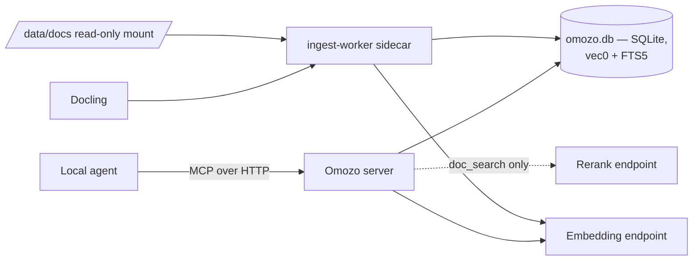

# Omozo 🧠

**Omozo is a local-first memory and document-retrieval layer for a small local agent.** It keeps durable memories about you — preferences, decisions, events, conversation summaries — and makes your document library (markdown, PDF, EPUB) searchable, then exposes both through exactly three MCP tools so the tool surface never overwhelms a context-limited model. The name is coined from 思 (thought) + 蔵 (storehouse): **a vault of thoughts**. It replaces my previous memory server, MemPalace.

AI tools were used during development.

## 🧭 How it works



One container serves the MCP server (streamable HTTP, optional bearer token); an optional sidecar runs scheduled ingestion. Both share a single SQLite file with `vec0` vector tables and FTS5 full-text indexes — one backup, no extra infrastructure. Embeddings and reranking come from your llama-server endpoints; Omozo itself needs no GPU and never calls a chat LLM: the agent composes its own memories (see [ADR-0003](docs/adr/0003-agent-composed-memories.md)).

## 🔧 The three tools

The MCP surface is capped at three tools ([ADR-0005](docs/adr/0005-three-tool-surface.md)); admin operations are CLI-only.

- `memory_search` — durable facts about the user: preferences, decisions, events, conversation summaries.
- `doc_search` — the ingested document library, with an optional source filter.
- `memory_save` — the agent persists a validated batch of atomic facts, optionally attaching the conversation transcript. Conflicting or duplicate memories supersede older ones with full history ([ADR-0004](docs/adr/0004-supersede-with-history.md)) — nothing is deleted at save time.

See [MCP tool contracts](docs/mcp-tools.md) for exact signatures, response formats, and the "no confident matches" behavior.

## 🔎 Search pipeline

Both searches are hybrid: vector KNN and full-text results are fused with reciprocal rank fusion, then filtered by confidence — vector-only hits below a per-route similarity floor are dropped (full-text matches are exempt), with an optional relative-gap rule. A cross-encoder reranks document search over the top fused candidates; if the rerank endpoint fails, searches degrade to fused order and reranking is disabled until restart. Similarity thresholds start as bge-m3 priors and are meant to be calibrated against real queries (`OMOZO_DEBUG_SCORES=1`). See [architecture](docs/architecture.md).

## 📥 Document ingestion

Docling converts PDF, EPUB, and markdown into tokenizer-aware chunks aligned to the embedding model, with section headers preserved as metadata. Ingestion is batch-based, never a file watcher: `omozo ingest --all` walks the configured read-only document roots, skips unchanged files by content hash, and re-chunks changed ones. Several roots at different host locations are supported; sources are labeled root-prefixed (`docs-1 » books/notes.md`). The compose sidecar `ingest-worker` reruns ingestion on a schedule ([ADR-0006](docs/adr/0006-docling-ingestion.md)). See [deployment](docs/deployment.md).

## 🚀 Quick start

1. Copy `example.env` to `.env`; set `OMOZO_EMBED_URL` (OpenAI-compatible embeddings endpoint), optionally `OMOZO_RERANK_URL`, `OMOZO_MCP_TOKEN`, and the document root `HOST_DOCS_1`. See [deployment and configuration](docs/deployment.md).
2. Create the data directory writable by the container's UID/GID:

   ```sh
   mkdir -p ./data
   export HOST_UID="$(id -u)" HOST_GID="$(id -g)"
   ```

3. Start the services:

   ```sh
   docker compose pull
   docker compose up -d
   docker compose logs -f omozo
   ```

4. Point your agent's MCP client at `http://<server>:9095/mcp` (with the bearer token, if configured), then ingest your library:

   ```sh
   docker compose exec omozo omozo ingest --all
   ```

The MCP server validates the embedding model and dimension at startup and refuses to run against a mismatched database — a model swap means re-embedding everything, and Omozo tells you so loudly. Uncomment the `ingest-worker` service in `docker-compose.yaml` for scheduled ingestion.

## 💾 Data and privacy

Everything Omozo stores lives in one SQLite file under `/data` on your own host. Queries send only the query text and, at save time, the facts the agent chose to persist, to the embedding endpoint you configure; document contents never leave the host (parsing happens in the container). Transcripts are stored only when the agent explicitly attaches them. Memory deletion is deliberate: superseded rows are purged only by `omozo gc`, single rows by `omozo forget`. Back up the complete `/data` directory. See [deployment](docs/deployment.md) and [architecture](docs/architecture.md#deliberate-limits).

## 🧪 Development

Use Python 3.12, [`uv`](https://github.com/astral-sh/uv), and [`just`](https://just.systems/man/en/):

```sh
uv sync --dev
just       # Format, lint, and sort imports
just check # Type, format, and lint checks
just test  # Test suite
```

Docling integration tests are opt-in (they download a tokenizer and convert real documents):

```sh
OMOZO_INTEGRATION=1 uv run pytest tests/test_docling_integration.py -q
```
